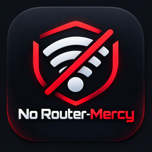
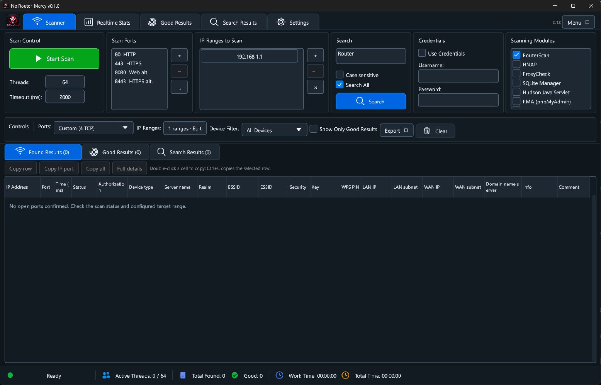
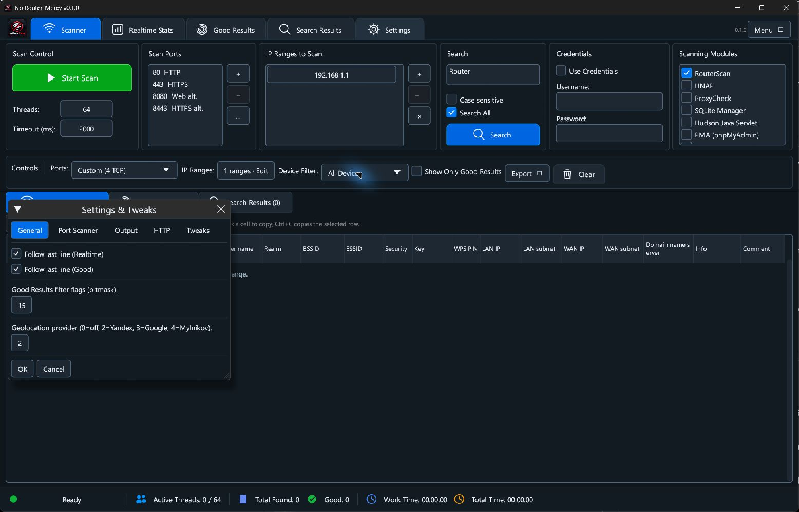

<p align="center">
  
</p>

<h1 align="center">No Router-Mercy</h1>
<p align="center">A native Windows desktop workspace for network discovery and router auditing.</p>
<p align="center">
  <a href="https://github.com/Mustafa1p/No-Router-Mercy/actions/workflows/ci.yml"></a>
  
  
  
</p>



No Router-Mercy brings IPv4 targets, port presets, live scan progress and device
results into one Rust/egui interface. It is an early release: device detection
depends on the target's firmware and response, and support varies by device.

Use it only on networks and devices you own or have permission to assess. The
application includes authentication and vulnerability probes, some enabled by
default. Review **Settings** and your target list before starting a scan. The
provided example configuration disables additional probe modules.

## Features

- **Flexible targets:** single IPv4 addresses, CIDR notation and address ranges.
- **Port selection:** editable port lists and built-in presets.
- **Scan controls:** start, pause, resume and stop, with progress and activity counters.
- **Device details:** HTTP metadata and device information when detected; supported
  parsers can also return network and wireless details.
- **Results workspace:** real-time, good-results and search views, filters,
  exclusions, cell copying and detailed result inspection.
- **Exports:** tab-separated text, CSV, JSON and `IP:Port` lists.
- **Windows integration:** native dialogs, application icon and per-user settings.

## Download and install

Open [GitHub Releases](https://github.com/Mustafa1p/No-Router-Mercy/releases) after
the maintainer publishes a release. Choose the file for your Windows architecture:

| Package | Intended use |
| --- | --- |
| `No-Router-Mercy-0.1.0-windows-x64-setup.exe` | Recommended for 64-bit Windows |
| `No-Router-Mercy-0.1.0-windows-x86-setup.exe` | 32-bit Windows; also runs on x64 Windows |
| `No-Router-Mercy-0.1.0-windows-<arch>-portable.zip` | Extract and launch without installation |
| `*.sha256` | SHA-256 checksum for the corresponding download |

Setup installs for the current user, creates a Start menu shortcut and offers an
optional desktop shortcut. Administrator privileges are not requested. Both
installer and ZIP builds store settings in the user profile by default. Windows
10 or later and a graphics environment compatible with egui are required. These
packages are unsigned unless the maintainer adds code signing.

Verify a download in PowerShell by comparing its hash with the `.sha256` file:

```powershell
Get-FileHash .\No-Router-Mercy-0.1.0-windows-x64-setup.exe -Algorithm SHA256
```

## First scan

1. Launch the application and review the scan modules in **Settings**.
2. Replace the initial target with the address of a device you are authorized to test.
3. Select a small set of ports and an appropriate thread count and timeout.
4. Start the scan and inspect the real-time results. Pause or stop as needed.
5. Search, filter or inspect a result, then export the records you need.

The initial target without a ranges file is `192.168.1.0/24`. To start with one
address and fewer modules instead, copy the files in [`examples/`](examples/)
into your application data directory **before launching**. Change the example
address to match your own device. No scan runs automatically at startup.

## Configuration and data



The default data directory is `%LOCALAPPDATA%\No-Router-Mercy`. Settings are saved
when you close the app. Relative file paths resolve inside this directory.

| File | Purpose |
| --- | --- |
| `config.ini` | Scan, HTTP, module, authentication and UI settings |
| `ports.txt` | One numeric TCP port per line |
| `ranges.txt` | One target address, CIDR or range per line |
| `filter.txt` | Good-result filter rules |
| `exclusions.txt` | Target exclusions |
| `auth_basic.txt`, `auth_digest.txt`, `auth_form.txt` | Optional credential-pair files |

Credential files use `username<TAB>password`; `<empty>` represents an empty value.
Settings and exports can contain passwords and device details. Keep those files
outside source control. Uninstalling the app leaves your user data in place.

Set `NRM_DATA_DIR` to use another writable directory. This also supports keeping
data alongside an extracted ZIP on a writable drive:

```powershell
$env:NRM_DATA_DIR = 'D:\No-Router-Mercy-data'
.\no-router-mercy.exe
```

## Build from source

Install [Rust](https://www.rust-lang.org/tools/install) and Visual Studio 2022
Build Tools with **Desktop development with C++**, the Windows SDK, and x86/x64
MSVC build tools. The repository pins Rust in `rust-toolchain.toml` and retains
`Cargo.lock` for repeatable dependency resolution.

```powershell
git clone https://github.com/Mustafa1p/No-Router-Mercy.git
cd No-Router-Mercy
cargo run --locked
```

Build a release for either architecture:

```powershell
cargo build --release --locked --target x86_64-pc-windows-msvc
cargo build --release --locked --target i686-pc-windows-msvc
```

Executables appear under `target/<target>/release/`. The MSVC runtime is linked
statically for both Windows targets. Build products are ignored by Git.

## Build Windows setup packages

Install [Inno Setup 6.3 or later](https://jrsoftware.org/isinfo.php), then run:

```powershell
./scripts/package-windows.ps1 -Architecture x64
./scripts/package-windows.ps1 -Architecture x86
```

The script builds from source and generates a setup executable, a ZIP and
checksums. By default, output goes into the sibling `No-Router-Mercy-releases`
folder, keeping binaries outside this source repository. Use `-OutputDirectory`
or `-IsccPath` to override the output or compiler location.

Tagged versions trigger the [release workflow](https://github.com/Mustafa1p/No-Router-Mercy/blob/main/.github/workflows/release.yml).
It tests and packages both architectures and creates a **draft** GitHub release
for review. A manual workflow run uploads build artifacts without creating a
release. See [RELEASING.md](docs/RELEASING.md) for the complete process.

## Development

```powershell
cargo fmt --all -- --check
cargo clippy --locked --all-targets
cargo test --locked
```

The test suite includes parser, range, result data, scan coordination,
HTTP fixture and UI interaction coverage. CI runs on Windows for x86 and x64.
See [CONTRIBUTING.md](CONTRIBUTING.md) for reporting and contribution guidelines.

```text
.
├── .cargo/               Windows compiler settings
├── .github/workflows/    CI and draft release automation
├── docs/                 Release guide, images and historical reference spec
├── examples/             Clean sample settings
├── installer/            Inno Setup definition
├── scripts/              Windows packaging script
├── src/                  Rust application and tests
├── src-media/            Embedded branding and Windows icons
├── Cargo.toml            Package metadata and dependencies
└── Cargo.lock            Locked dependency versions
```

## Scope and limitations

IPv4 is supported; IPv6 is not implemented. This project does not promise feature
parity with Router Scan. The [historical reference spec](docs/REFERENCE_SPEC.md)
describes a separate product, including features absent here. Some settings
shown in the UI are incomplete, including autosave and external service features;
use explicit file export for saving results. Test compatibility with your devices
and Windows environment before relying on results.

## License and credits

A project-wide license has not yet been selected. Public availability alone does
not grant permission to reuse or redistribute the code. Before publishing binary
releases, the owner should confirm source and artwork provenance and choose an
appropriate license. See [third-party notices](THIRD_PARTY_NOTICES.md), including
the existing GPLv3 reference in the probe sources.

Built with Rust, eframe/egui, reqwest/rustls and the dependencies listed in
`Cargo.toml`. This project is independent of Router Scan and its authors.
